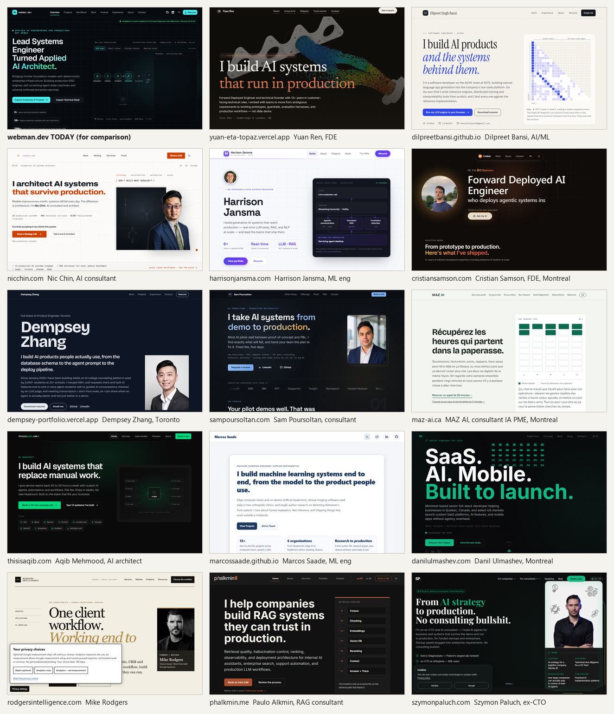

# Portfolio positioning research: being the answer for recruiters and CEO/CTO buyers

Research date: 14 October 2026. Prepared for Nicolas Desjardins (webman.dev).

## How this was done

- **Search sweeps.** Nine searcher personas ran about 90 queries in English and French. The personas were an agency recruiter, a French-speaking Montreal recruiter, a CEO who does not know the technical words, a CTO who does, a Bing and answer-engine user, a peer-praise collector, a listicle miner, a hiring manager looking at people who already hold the target titles, and a buyer looking at independent consultants.
- **Portfolio reads.** 59 individual portfolios were read in full from their HTML. Every strong one was then checked by three independent reviewers for credibility, clarity and relevance to you.
- **Visual check.** I screenshotted 17 home pages at 1280x800, including webman.dev. Agents read code, not pixels, so the visual verdicts below are mine. The contact sheet is [portfolio-exemplars-2026.png](portfolio-exemplars-2026.png).
- **Job postings.** Current postings were read at all 20 target companies from your career guide, plus Maplr and Chrono.
- **Background research.** Three research passes covered how recruiters source, how AI-company hiring managers judge, and how SMB leaders buy. Three more covered personal-site SEO, answer engines, and bilingual Quebec SEO. Together they cite more than 150 sources, mostly from 2025 and 2026.
- **Site audits.** Four readers audited webman.dev as a non-technical CEO, an agency recruiter, a mid-size CTO, and a francophone Quebec recruiter. A fifth ran a technical SEO audit.

**Limits.** Google rankings were not measured directly because the shared search budget ran out. The rank checks below come from Brave Search. Search results are biased toward North American engines. The portfolio sample is the set that searches and peers surfaced, so it leans toward sites that already rank or get praised.

---

## 1. The short answer to your four questions

**1. "Too much tech language."** Every audit agreed. The non-technical CEO read the first screen and would not have contacted you. The phrases that lost them were "frontier foundation models", "deterministic", "agent state machines", "Enterprise", and "Forward Deployed". The recruiter nearly closed the tab at the headline and stayed only because of the availability pill. The CTO trusted the evidence but read the headline as overclaiming. The French recruiter read "Ingénieur systèmes" as an infrastructure title. Everything a buyer needs is already on the page, buried under the vocabulary. The CEO auditor said it directly: put the name and a plain promise first, the business outcomes second, and the technical depth behind a toggle, and they would write the same day.

**2. SEO for recruiters and CEO/CTO buyers.** There is a hard truth here. For queries like "applied AI engineer Montreal", "RAG developer for hire", "senior AI engineer remote Canada" and "ingénieur IA Montréal disponible", the top ten results are job boards, marketplaces and staffing shops. No personal site appeared on any of them. Recruiters find people on LinkedIn and GitHub, then Google the name. CEOs mostly find consultants through referrals, then check the site. So the site's job is to:
- win your name and your project names,
- convert people who arrive from LinkedIn, a resume or a referral,
- rank for specific problems described in plain words, where individuals can rank, and
- be quotable by AI answer engines.

A large technical problem also stands in the way. **The French edition cannot be seen by Google or any answer engine today.** The details are in section 5.

**3. Name as the header, and the "corporate" look.**
- 48 of the 59 portfolios show the person's name on the first screen.
- Only 19 use the name itself as the H1 headline.
- 31 show a photo.

webman.dev is in the small minority that shows no name at all. The first screen has only "ND" and "webman.dev", and "webman" collides with a PlayStation 3 homebrew tool and a PHP framework in search. The best hire-me pages use one of two patterns. Some make the name the headline with a plain promise under it, such as Harrison Jansma and Dempsey Zhang. Others make a plain promise the headline with the name and a photo right beside it, such as Yuan Ren, Nic Chin and Sam Poursoltan. Either works. Neither hides the person.

Looking at the screenshots, the dark navy look with cyan and violet glow is the 2026 default for AI portfolios. Two separate reviewers called it "interchangeable". That is the "corporate" feeling you describe. The pages that stand out add a face, warmer colour or a light background, and sometimes a serif display font. They keep the professionalism.

**4. What the top portfolios do differently.** They put a person, a plain promise and proof on the first screen, then let the reader click into depth. Section 2 lists the patterns.

---

## 2. What the best portfolios actually do

### Counts from the 59 portfolios read

| Feature | Portfolios | Share |
|---|---|---|
| Name visible on the first screen | 48 | 81% |
| Name is the H1 headline | 19 | 32% |
| Photo of the person | 31 | 53% |
| Has a blog or writing section | 31 | 53% |
| Has separate case-study pages | 26 | 44% |
| Has JSON-LD structured data | 32 | 54% |
| Plain language on the first screen | 12 | 20% |
| Mixed: plain first, jargon below | 45 | 76% |
| Jargon-heavy on the first screen | 2 | 3% |

The two jargon-heavy pages were both judged poor models. Mixed language is the norm: a plain first layer, then technical detail.

### The patterns that recur on the strong pages

1. **A person on the first screen.** The name appears in the header, the headline or a byline, usually with a face, a city and a status line such as "Available for work" or "Currently accepting 2 new clients this quarter".
2. **One plain promise, about 8 to 15 words, with a verb.** Examples:
   - Yuan Ren: "I build AI systems that run in production"
   - Paulo Alkmin: "I help companies build RAG systems they can trust in production"
   - Dilpreet Bansi: "I build AI products and the systems behind them"
   - Aqib Mehmood: "I build AI systems that replace manual work"
   - MAZ AI: "Récupérez les heures qui partent dans la paperasse"

   None of them uses a "X turned Y" story headline.
3. **A subline that gives the outcome, not the stack.** Aqib Mehmood's is the clearest: "I give service teams back 20 to 30 hours a week... Flat fee. Ships in weeks." Dempsey Zhang's paragraph names real usage, "2,000+ students at 20+ schools", before naming any tool.
4. **Proof next to the claim, with a source.** Nic Chin shows "13 production systems · 94% retrieval hit-rate · 0/297 hallucinated citations" and links a /proof page. Chaitanya Sai labels every project Implemented Public, Implemented Private, In Progress or Platform Direction. That is your measured-versus-target rule, made visible.
5. **Two calls to action.** Recruiter-facing sites pair "View work" with "Download resume". Buyer-facing sites use "Book a 30-min call" or "Request a review".
6. **Two layers of content.** Eugene Yan's technical headings follow a "jargon: to plain purpose" pattern, for example "Evals: To measure performance" and "Caching: To reduce latency and cost". Joyce Bessis explains a featured project in three plain steps, then "View case study" opens the stack. Mike Rodgers puts zero stack nouns above the fold and writes the GitHub README as "the review path for hiring managers".
7. **More than one URL.** The sites that rank on problem queries have a page per service or problem, such as /hire-rag-developer and /en/rag-systems-consultant/. Eugene Yan's sitemap has 258 URLs. webman.dev has one.
8. **Title tag "Name | searchable role".** Examples are "Marcos Saade | Machine Learning Engineer", "Chaitanya Sai | Applied AI Engineer" and "Harrison Jansma, Machine Learning Engineer & Data Science Manager". Buyer pages flip it to "[service phrase] | Name".

### How individuals actually rank

- **GitHub repositories often outrank the person's own site.** Chaitanya Sai reached #2 on Google for "applied AI engineer portfolio" through a repo named Portfolio. The description starts with "Applied AI engineering portfolio" and the repo has the matching topics. Mike Rodgers ranks for "forward deployed engineer" through a repo named fde-portfolio, not through his website.
- **Individuals appear when the query contains "independent", "consultant" or "production systems".** One such query returned five solo practitioners in its top nine. Queries built on "hire", "contractor", "available" or a job title return only job boards.
- **The French long tail is open.** A Montreal freelance web developer with no AI content ranks top five for a French freelance query. No bilingual Quebec AI individual ranked on any French query tested.

---

## 3. Portfolios worth looking at

I chose these after seeing each one. Each passed at least two of three reviewers, unless noted.

### For recruiters, where you are the candidate

| Site | Who | What to take |
|---|---|---|
| [dempsey-portfolio.vercel.app](https://dempsey-portfolio.vercel.app/) | Dempsey Zhang, Full Stack AI Product Engineer, Toronto | The closest profile to yours in Canada. It shows role and city, then the name as H1, then a plain pitch, then real usage numbers, a photo, "Download resume" and "Email me". A recruiter learns everything in five seconds. All three reviewers passed it. |
| [harrisonjansma.com](https://harrisonjansma.com/) | Harrison Jansma, ML engineer and GenAI lead | The cleanest name-first hero: photo, role pill, name, one plain sentence, three stat tiles and two buttons. The architecture card on the right is the job your 3D simulator could do, labelled in plain words. |
| [yuan-eta-topaz.vercel.app](https://yuan-eta-topaz.vercel.app/) | Yuan Ren, Forward Deployed Engineer, UK | The best Forward Deployed positioning. It leads with a serif promise, then the Forward Deployed eyebrow, then plain sentences, with the name and city as a byline. It is dark, but warm rather than corporate. |
| [dilpreetbansi.github.io](https://dilpreetbansi.github.io/) | Dilpreet Bansi, AI/ML, Toronto | The most distinctive page in the set: a cream background, a serif italic headline, and a live "Run my LLM engine in your browser" button. It proves a light editorial look can read as senior and technical. Six of six reviews passed. |
| [cristiansamson.com](https://www.cristiansamson.com/) | Cristian Samson, Forward Deployed AI Engineer, Montreal, bilingual | Your direct local comparator: same target title, same city, and a French edition with its own URL and hreflang. It shows a photo, "Hi, I'm", and a 30-minute call. Use it as a benchmark, not a template. |
| [marcossaade.github.io](https://marcossaade.github.io/) | Marcos Saade, ML engineer | The best recruiter-facing title and meta description in the set. The page is plain and light, with employers and users named in the first paragraph. |

### For CEO/CTO buyers, where you are the contractor

| Site | Who | What to take |
|---|---|---|
| [nicchin.com](https://nicchin.com/) | Nic Chin, AI consultant and architect | A plain promise, a photo, a proof bar backed by a /proof page, "every claim verifiable", and a section on "when AI is the wrong fit". It is the closest analogue to your measured-numbers culture. |
| [sampoursoltan.com](https://sampoursoltan.com/) | Sam Poursoltan, AI consultant | It opens with the buyer's pain: "Most AI pilots stall between proof-of-concept and P&L." It has a fixed-fee menu and three anonymised failure case studies. One is silent line-item loss in document extraction, which is your exact domain. |
| [thisisaqib.com](https://thisisaqib.com/) | Aqib Mehmood, AI architect | The best case-study template: the pain, what I built, the outcome, the stack, with before and after numbers. The palette is generic, so take the copy and structure only. |
| [phalkmin.me/en/rag-systems-consultant](https://phalkmin.me/en/rag-systems-consultant/) | Paulo Alkmin, RAG consultant | The nearest analogue to your compliance retrieval engine. It has a service-specific URL under /en with a Portuguese twin, and its meta description names the pains, such as poor retrieval and hallucinations. |
| [rodgersintelligence.com](https://rodgersintelligence.com/) | Mike Rodgers, Denver | A cream editorial page with zero stack nouns above the fold and honest labels like "Demonstration, not a client result". Only one of three reviewers passed it as a whole, but its two-layer ladder is the best seen. |

### For the French edition

| Site | Who | What to take |
|---|---|---|
| [maz-ai.ca](https://maz-ai.ca/) | Denis Mazerolle-Imbeault, consultant IA pour PME, Montréal and Laval | The best plain-French model: "Récupérez les heures qui partent dans la paperasse." It uses Quebec vocabulary, promises "sans jargon", and offers one 20-minute call. Only one of three reviewers passed it, because it has no real case studies. |
| [mcourte.github.io](https://mcourte.github.io/) | Magali Courté, Ingénieure Data & IA Générative | The best French structure: name as H1, a dated availability badge, a CV download, and numbered sections. The visual style is heavy, so take the structure only. |

### Looked at, not recommended as models

- **joycebessis.com.** Every page carries a noindex tag, so it cannot rank.
- **chaitanya-sai-portfolio.vercel.app.** The first screen is jargon-heavy.
- **arjunthakur.dev.** The keywords are stuffed and the title tag runs to 190 characters.
- **akshit.wtf.** It opens on a terminal boot-screen gimmick.
- **eugeneyan.com.** Copy its content model, not its look.
- **danilulmashev.com.** It is not an AI role, but it is the only Montreal individual that ranked on a French freelance query.

---

## 4. The two-layer content model for webman.dev

The rule: **every section opens with what it does for a business in plain words, then offers "How it works" for engineers.** Nothing technical is deleted. It moves one click down, into an expandable panel on the home page or onto a dedicated project page.

This is not dumbing down. The employers you target ask for the same skill in their own postings:
- Mistral: "explain complex technical concepts in simple terms with technical and non-technical audiences"
- Cohere: "toggle seamlessly between presenting to CEOs, and getting in the weeds with technical audiences"

The site itself becomes the work sample.

### Hero: before and after

**Today:**
> Eyebrow: Applied AI Engineering for production, not demos
> H1: Lead Systems Engineer Turned Applied AI Architect.
> Sub: Bridging frontier foundation models with deterministic enterprise infrastructure. Building production RAG engines, self-correcting agent state machines, and schema-enforced extraction services.
> Buttons: Explore Enterprise AI Projects / Inspect Technical Stack

Problems the audits found:
- No name appears.
- "Systems Engineer" reads as infrastructure or SRE in Quebec postings.
- "Architect" is self-conferred and matches no query anyone types.
- "Self-correcting agent state machines" describes Phase 3, which is not built yet.
- "Deterministic" invites a technical reader to push back.
- Neither button gives a recruiter what they came for, which is the resume.

**Option A: name as headline, for recruiters first.** This is the Jansma and Zhang pattern.
> Small line: Applied AI Engineer · Greater Montreal · English and French
> H1: Nicolas Desjardins
> Promise: I build AI that reads your documents, answers from your own files with the source quoted, and keeps working when a provider goes down.
> Proof line: 8+ years running production web systems for New Roots Herbal Inc. Two AI services live with public code.
> Buttons: See what I've built · Download resume
> Availability: Open to Applied AI and Forward Deployed roles. Hybrid in Montreal or remote in Canada and the US.

**Option B: promise as headline, name attached, for buyers first.** This is the Yuan Ren and Nic Chin pattern.
> Byline with photo: Nicolas Desjardins, Applied AI Engineer, Greater Montreal
> H1: AI that reads your documents and gets the numbers right.
> Sub: I connect AI models like Claude and GPT to the systems a company already runs, and every answer is checked before it reaches your books or your customers.
> Buttons: See it read an invoice · Tell me what is piling up

For the home page, I recommend Option A. Recruiters and Google's "name search" both need the name as the main heading. Option B's sentence still works as the Promise line, and it belongs as the headline of future problem pages.

**French, Option A:**
> Petite ligne : Développeur principal et spécialiste en IA appliquée · Grand Montréal · bilingue
> H1 : Nicolas Desjardins
> Promesse : Je conçois des outils d'IA qui lisent vos documents, répondent à partir de vos propres fichiers en citant la source, et continuent de fonctionner quand un fournisseur tombe en panne.
> Boutons : Voir ce que j'ai construit · Télécharger le CV
> Disponibilité : Ouvert aux postes en IA appliquée. Hybride à Montréal ou à distance au Canada et aux États-Unis.

"Ingénieur" is deliberately avoided until you confirm the question in section 8. Use "postes", not "rôles", which the French recruiter flagged as an anglicism.

### New section: "What I can build for your company"

Put this right under the hero. It answers your own question: what if a company needs something but does not know what it is called? Each row names the problem in the buyer's words, then the technical name, then the proof.

| The problem, in their words | What it is called | Proof on the site |
|---|---|---|
| Invoices, purchase orders and forms are still retyped by hand | Schema-enforced document extraction (FastAPI, Pydantic, model fallback chain) | Invoice Extraction Service: 21 of 21 fully correct on the dated 7 October 2026 benchmark (measured) |
| Staff cannot find answers in our procedures and regulatory manuals | Hybrid retrieval with verified citations (pgvector plus full-text search, RRF, cross-encoder re-rank) | Compliance Retrieval Engine: 6 of 6 recorded questions answered with verified quotes, 1 of 1 out-of-scope question declined (14 October 2026, measured) |
| A multi-step back-office task needs a person to approve the risky steps | Supervised AI agents with human approval (LangGraph) | Planned, labelled as target |
| We changed a prompt and do not know if answers got worse | Evaluation in CI, tracing and caching (LLMOps gateway) | Planned, labelled as target |
| Our websites and store must not go down when we change servers | Infrastructure migration and web platform engineering | 30+ properties migrated with zero downtime, and hosting cost down over 40%, at New Roots Herbal Inc. |

French row labels, using the words Quebec buyers use:
- extraction de données de factures
- recherche dans vos procédures et manuels, avec citation de la page
- automatisation de processus avec approbation humaine
- savoir si l'IA donne encore la bonne réponse après un changement
- migrations de sites sans interruption

### Project cards: before and after

**Invoice Extraction Service.** Today it opens with "An asynchronous FastAPI microservice that turns messy, unstructured documents into a guaranteed, schema-validated invoice record."
> **Invoice reader:** turns PDFs, scans and forwarded emails into clean data your accounting system can import. If one AI provider is slow or down, it switches to another on its own. 21 of 21 test invoices came back fully correct on the 7 October 2026 benchmark.
> *How it works ▸* (the current architecture paragraph, unchanged)

**Context-Aware Hybrid Compliance Retrieval Engine.** Today it opens with "A retrieval engine for SOPs and regulatory manuals that answers only by quoting the source."
> **Ask your manuals:** staff ask a question about your procedures or regulations and get an answer that quotes the exact passage and page. When the documents do not say it, the answer says so.
> *How it works ▸* (the current architecture paragraph, unchanged)

Your sentence "When the documents do not say it, the answer says so." was called the most reassuring line on the site by both the CEO and the French recruiter. Move it up.

Rename the long titles and keep the technical name as a subtitle:
- "Invoice reader (schema-enforced extraction service)"
- "Ask your manuals (hybrid compliance retrieval engine)"

### Section headings

Use the "plain purpose, then technical subtitle" pattern:

| Today | Suggested |
|---|---|
| Deterministic AI systems, built for production. | AI tools that check their own work. *Subtitle: schema validation, model fallback, verified citations* |
| Shipped for the web since 2004. | Building websites and online stores since 2004. |
| The Engineering Arsenal | Skills and tools. Collapse the history by default and show what you ship with today first. |

### Navigation

| Today | Suggested EN | Suggested FR |
|---|---|---|
| Overview | (drop it, the logo goes home) | (drop it) |
| Projects | AI projects | Projets IA |
| NextBlock | NextBlock | NextBlock |
| Work | Web work | Sites web |
| Arsenal | Skills | Compétences |
| Experience | Experience | Parcours |
| About | About | À propos |
| Contact | Contact | Contact |

The recruiter persona said it looks for "Skills" in a nav and would never click "Arsenal".

### Contact block

**Today:** "If you are shipping foundation models into a real business and you need someone who treats schema validation, latency budgets, and failure modes as first-class requirements, we should talk."

The CEO read this as "this is not for me" at the exact moment they were ready to write. **Suggested:**
> Hiring an AI engineer, or have invoices, documents or customer emails piling up? Write to me. I reply within one business day.
> *For technical teams: I treat schema validation, latency budgets and failure modes as requirements, not afterthoughts.*

---

## 5. SEO: becoming the answer

### What each searcher types, and where they should land

| Searcher | What they actually do | What should answer them |
|---|---|---|
| Agency or in-house recruiter | Finds you on LinkedIn, often with LinkedIn's AI Hiring Assistant, or on GitHub, then Googles "Nicolas Desjardins". One study measured a median of 31 seconds per engineer resume. | The home page, ranking #1 for your name, with name, title, city, availability and resume on the first screen. LinkedIn and GitHub must use the same words as the site. |
| CEO who does not know the words | Describes a task: "automate invoice processing", "AI assistant trained on our documents", "chatbot for our procedures". Hires consultants far more often than staff. Statistics Canada found 18.2% of AI-using firms used vendors or consultants, against 4.9% that hired AI-trained staff. | A problem page per use case, such as /projects/invoice-data-extraction and /fr/projets/extraction-de-factures, with a plain headline, a short case study and a contact button. |
| CTO who knows the terms | Types "RAG consultant", "document extraction with LLM", "hybrid search pgvector citations". | The same project pages, with the technical write-up under the plain summary, plus one or two dated write-ups on the domain. |
| AI answer engines (Google AI Overviews, ChatGPT, Perplexity) | Answer "who can build X in Montreal" mostly from third parties, especially LinkedIn. Quote short, clear statements. | A plain entity sentence near the top that can be quoted as is, repeated word for word on LinkedIn, GitHub and nextblock.dev. |

### What not to chase

- **Head terms like "applied AI engineer Montreal".** All ten results were job boards on Brave on 14 October 2026, and Mistral's own postings take the top spots.
- **"Hire [framework] developer" phrases.** Offshore staffing shops own them.
- **Separate city pages for Laval, Longueuil and Quebec City.** Google classes these as doorway spam.
- **A Google Business Profile.** Skip it unless you meet clients in person.
- **The keywords meta tag.** Google states it does not read it.

### Where webman.dev stands today (Brave Search, 14 October 2026)

| Query | webman.dev rank | What outranks it |
|---|---|---|
| Nicolas Desjardins | 13 | A namesake "AI & Innovation Leader" on LinkedIn at #1 |
| Nicolas Desjardins Montreal | 4 | A Montreal footballer, and a namesake Montreal web developer |
| Nick Desjardins developer | 1 | Ranks on the old 2018 page. The new page never shows "Nick". |
| webman.dev | 2 | A PlayStation 3 homebrew tool called webMAN MOD |
| NextBlock CMS | absent | nextblock.dev at #1. Nothing links the product to you. |
| applied AI engineer Montreal | absent | 10 of 10 are job boards |
| ingénieur IA appliquée Montréal | absent | Universities and job boards |

The index still holds the pre-rebuild site: the title "Webman", 2018 snippets, and /assets/resume.pdf, which now returns a 404 error.

### Fixes, in priority order

1. **Make French visible (high).** Today a cookie-free request to /fr gets a 308 redirect to the English page. Both editions declare https://webman.dev as their canonical. There are no hreflang tags, and the sitemap lists one URL. Googlebot sends no language header and keeps no cookies, so it only ever sees English. Google explicitly recommends one URL per language and no automatic redirects. The fix:
   - Serve /fr as a real page and stop the redirect in proxy.ts.
   - Give each edition its own canonical.
   - Add the en-CA, fr-CA and x-default alternates in the layout's metadata.
   - List both URLs in the sitemap.
   - Make the FR switch a real link.

   This partly reverses the single-URL setup you chose on 9 October for instant switching. Switching can stay instant in the browser while also updating the address to /fr. **This one is your call.**
2. **Name first, everywhere (high).** Put the name in the H1 or a name line above it, in the header logo text in place of "webman.dev", and in About, Contact and the footer. Mention "Nick" once in visible text. Title tags:
   - EN: "Nicolas Desjardins | Applied AI Engineer, Montreal" (50 characters)
   - FR: "Nicolas Desjardins | Développeur et spécialiste en IA appliquée, Montréal"

   Keep meta descriptions under 160 characters, in plain words, with one measured proof.
3. **Tell search engines the site changed (high, small effort).**
   - Verify the domain in Google Search Console and Bing Webmaster Tools.
   - Submit the sitemap and request reindexing of / and /fr.
   - Enable IndexNow.
   - Add a 301 redirect from /assets/resume.pdf to the current resume.
   - Set a Title and Author on the resume PDFs.
4. **Have your own properties vouch for you (high, small effort).** Search engines connect a person to their work through consistent mentions:
   - nextblock.dev does not contain your name.
   - The npm author on all 8 packages is "NextBlock CMS".
   - Neither github.io project page links to webman.dev.
   - Your GitHub profile says "Programmer", with PcSquad as the company.

   Fix these:
   - Add "Created by Nicolas Desjardins" with a link on nextblock.dev.
   - Set the npm author to "Nicolas Desjardins (https://webman.dev)".
   - Add footers on the github.io pages.
   - Update the GitHub bio and add a profile README.
   - Rewrite repository descriptions to start with the role phrase. That last step is how two people in the study reached Google's top results.
5. **Give each project its own page (medium to large).** Create /projects/invoice-data-extraction, /projects/compliance-document-search and /nextblock, with French twins. Each page gets its own plain H1, title, description, case study, technical section and structured data. The home page cards link to them. These pages are what can rank for problem queries.
6. **Clean up the structured data (medium).**
   - Make the Person jobTitle match the visible role line.
   - Add your photo, knowsLanguage (en, fr) and a dateModified.
   - Use "Montréal" in the French edition.
   - Remove the keywords meta tag.
   - Replace the build-time lastmod in the sitemap with real content dates.
7. **Publish two or three first-hand write-ups (medium).** Date them and put your byline on them, on webman.dev first. For example: how the 21 of 21 benchmark was built, and what verified citations caught in the retrieval engine. Anthropic tells candidates to put writing near the top of the resume. Its Applied AI Engineer role includes writing public posts.
8. **Get listed where people already look (low effort).**
   - hellodarwin, the Quebec directory that dominates French AI-consultant searches.
   - The portfolio listicles that cite real sites: Colorlib, Myseera, and emmabostian/developer-portfolios on GitHub.
9. **Keep llms.txt (low).** Answer engines barely read it. Add a three-sentence plain "what I do for companies" block at its top so it stops repeating the jargon.

### What Google will realistically do

Within a few months, a one-person site can win:
- your name and your project names,
- long-tail problem pages, especially in French, and
- quotes in AI summaries.

It will not outrank Indeed, Glassdoor or Mistral's careers page for job-title searches. LinkedIn and referrals stay the main door. In one consultant survey, 70% of consultants get zero leads per month from their website. The site wins by converting the people who arrive and by being consistent with LinkedIn and GitHub. Recruiters cross-check profiles for fraud, and a site with no name and no face is harder to tie to a real person.

---

## 6. Vocabulary to mirror, from the target companies' own postings

### Titles in use, 14 October 2026

| Title family | Who uses it |
|---|---|
| Applied AI Engineer | Anthropic, OpenAI, Mistral (Paris), PSP Investments ("Senior Applied AI Engineer / Ingénieur(e) senior en IA appliquée"), LangChain ("Lead Applied AI Engineer") |
| Forward Deployed Engineer | OpenAI, Palantir ("Forward Deployed AI Engineer"), Cohere, Coveo ("Ingénieur de déploiement (FDE)"), Mistral Montreal ("Applied AI, Forward Deployed Engineer"), CGI |
| Deployed Engineer | LangChain |
| Applied ML Engineer | Shopify, which never uses "Applied AI" |
| AI Solutions Architect / Solutions Engineer | Deloitte, CGI, Talan ("Architecte de solutions SAP BTP et IA"), Braintrust, Scale |
| Applied AI Architect | Anthropic and OpenAI, but as a pre-sales title |

Nobody posts "Lead Systems Engineer". The French title "Ingénieur déployé chez le client", currently in your French keywords, appears in no posting. Quebec postings use:
- développeur IA
- ingénieur IA
- spécialiste en IA appliquée
- conseiller en IA
- architecte de solutions IA
- Ingénieur de déploiement (FDE), at Coveo
- ingénieur en IA déployée sur le terrain, at Bell

### Phrases that recur, with a plain version for the first layer

| Their phrase | Source | Plain first-layer version |
|---|---|---|
| "from prototype to production", "not demos, not research" | LangChain, Coveo, OpenAI, Deloitte | "AI that works every day, not just in a demo" |
| "translate ambiguous business needs into concrete technical specs" | Cohere, LangChain | "I turn a vague request into something that ships" |
| "reliable, observable, safe, and auditable from day one" | Cohere | "You can see what it did and why" |
| "evaluation frameworks", "Evaluate outputs with real test sets, measure accuracy" | Nearly every posting, including Talan | "I measure whether it is right before it ships" |
| "document search, information extraction" | CGI | "Search your documents, pull data out of them" |
| "structured, decision-ready output" | PSP | "Clean data you can act on" |
| "invoice validation", "safeguards and rollback plans" | Talent.com | "Invoice checks with a safety net" |
| "Document Information Extraction", "limit the consequences of incorrect outputs" | Talan | "When the AI is unsure, a person decides" |
| "human-in-the-loop" | Deloitte, Scale, CGI | "A person approves the risky steps" |
| "explain complex technical concepts in simple terms" | Mistral | (the site itself is the proof) |

### Facts from the postings that should shape the site

- **Bilingual EN/FR is a hard requirement** in two of three Mistral Montreal engineering roles, in every Deloitte role with a Quebec location, and in Talan's Montreal roles. Say "English and French" as a fact on the first screen, not only through the FR switch.
- **Evaluation is required in nearly every posting.** Show how the benchmark and recorded runs were built, not only the scores.
- **Python is listed first everywhere.** Give it equal visibility with TypeScript.
- **Founders and consultants are explicitly welcome** at Anthropic, OpenAI and LangChain. Present PcSquad (2012 to 2018) as customer-facing consulting experience.
- **Most US Forward Deployed roles are hybrid** in SF, NYC, Seattle or London, with 25 to 50% travel. Cohere is remote-friendly and has a Montreal office. Two of its three Canadian Forward Deployed roles mention Top Secret clearance. Mention your RCEME service, and clearance only if eligibility is confirmed.

---

## 7. Design direction

What I saw comparing the 17 screenshots:

- **webman.dev today** is polished and fast. It sits in the dark, glowing "AI SaaS" style that two reviewers called the interchangeable 2026 default. The 3D pipeline simulator impresses engineers, but the CEO "cannot interpret" it.
- **Pages that feel personal without losing seniority** do one or more of these things:
  - show a face, as Zhang, Jansma, Chin, Poursoltan and Samson do,
  - use a light or cream background, as Bansi, Chin, Jansma, Saade and MAZ AI do,
  - use a serif or editorial display font, as Yuan Ren, Bansi and Rodgers do,
  - use one warm accent, orange or terracotta, as Chin, Yuan Ren and Alkmin do.

Keep:
- **The performance work and the measured-versus-target labels.** No other site does the labels as rigorously except Chaitanya Sai.
- **The simulator.** Give it a plain caption such as "A messy invoice goes in, clean checked data comes out", and consider moving it below the fold on phones. On a phone today, the first screen is the slogan and empty space.
- **The About section's humour.** Both the CTO and the French recruiter flagged the joke statistic, "68.6% of statistics are made up", because it sits near real metrics. Keep the humour in prose and drop numeric jokes.

Change:
- **Add your photo to the hero.** You have one already: "Actual photo. Not generated."
- **Put your name in the header** in place of "webman.dev".
- **Consider a light theme option or a warmer accent.** This is a taste decision. Pick two or three of the exemplars you like and match their feel.

---

## 8. Things on the site that are wrong or risky today

1. **The resume tagline says "Two pages. No buzzword bingo."** Both PDFs are four pages, checked on 14 October 2026. A recruiter notices in one click, on a site whose pitch is that every number has a source.
2. **The hero claims "self-correcting agent state machines"** as current work. That is Phase 3, still labelled planned.
3. **"Ingénieur" is a reserved title in Quebec,** under the Ordre des ingénieurs du Québec. The French copy uses it in nine places, and the French recruiter said a Quebec recruiter would ask about membership. If you are not a member, use "développeur", "spécialiste" or "architecte logiciel" instead. This is a flag to verify, not legal advice.
4. **The Arsenal lists Internet Explorer, Norton, McAfee, CCleaner, Skype and Flash** in the full grid. The CTO read this as "lists everything rather than depth". Collapse the history by default.
5. **The availability pill says "roles" only,** and the contact section says "engagements". Buyers cannot tell whether you take contracts. Decide what is true and say it plainly.
6. **The French share image's alt text is in English.**

---

## 9. Prioritised action list

| # | Action | Effort | Impact | Why |
|---|---|---|---|---|
| 1 | Serve French at /fr with hreflang and sitemap entries | Small to medium | High | French is invisible to every engine today. Google's own guidance. |
| 2 | Name and photo in the hero, name in the header and title tag | Small | High | All four audits. 48 of 59 portfolios show the name. Name searches are how recruiters verify. |
| 3 | Plain-language hero and "What I can build for your company" block, EN and FR | Small | High | CEO audit would not contact. Recruiter nearly left. SMB buyers describe tasks, not techniques. |
| 4 | Fix the four-page resume claim and the planned-work claim in the hero | Small | Medium | Credibility on a site built on sourced numbers. |
| 5 | Decide the French title question ("ingénieur") | Small | Medium | Reserved title in Quebec. |
| 6 | Search Console and Bing verification, reindexing, the resume redirect | Small | Medium | The index still shows the 2018 site. |
| 7 | GitHub bio and README, npm authors, nextblock.dev credit, github.io footers | Small | High | Connects NextBlock and the AI projects to your name. GitHub repos rank for role queries. |
| 8 | "How it works" toggles on project cards, renamed project titles, nav labels | Medium | High | The two-layer model without losing technical depth. |
| 9 | One page per project, EN and FR, with case-study structure | Medium to large | High | The only way to rank for problem queries. Gives the sitemap more than one URL. |
| 10 | LinkedIn headline and About mirroring the hero sentence, EN and FR | Small | High | LinkedIn is where recruiters find you. AI answer engines cite it. |
| 11 | Two dated first-hand write-ups | Medium | Medium | Anthropic and Google both reward first-hand writing. Gives CTOs depth. |
| 12 | Visual refresh: warmer accent or light option, simulator caption, mobile first screen | Medium | Medium | Moves the look from "template" to "person". |
| 13 | hellodarwin profile and listicle submissions | Small | Low to medium | Where Quebec buyers look, and backlinks. |

---

## Sources

The full notes, with every URL, are in the session scratchpad. The most important sources:

**Google documentation:**
- [Managing multilingual sites](https://developers.google.com/search/docs/specialty/international/managing-multi-regional-sites)
- [hreflang](https://developers.google.com/search/docs/specialty/international/localized-versions)
- [Locale-adaptive pages](https://developers.google.com/search/docs/specialty/international/locale-adaptive-pages)
- [ProfilePage](https://developers.google.com/search/docs/appearance/structured-data/profile-page)
- [Title links](https://developers.google.com/search/docs/appearance/title-link)
- [Snippets](https://developers.google.com/search/docs/appearance/snippet)
- [Spam policies](https://developers.google.com/search/docs/essentials/spam-policies)
- [SEO Starter Guide](https://developers.google.com/search/docs/fundamentals/seo-starter-guide)
- [Helpful content](https://developers.google.com/search/docs/fundamentals/creating-helpful-content)

**Recruiting:**
- interviewing.io, [recruiters versus a coin flip](https://interviewing.io/blog/are-recruiters-better-than-a-coin-flip-at-judging-resumes)
- ResumeGo, [time per resume](https://www.resumego.net/research/how-much-time-spend-resume/)
- Greenhouse, [candidate fraud](https://www.greenhouse.com/blog/detecting-candidate-fraud)
- ERE, [LinkedIn Hiring Assistant 2](https://www.ere.net/articles/linkedins-hiring-assistant-2-aims-to-just-be-smarter)
- Boolean Strings, [LinkedIn X-ray](https://booleanstrings.com/2024/02/29/death-of-linkedin-x-ray-what-next/)

**SMB buyers:** Statistics Canada business conditions surveys (Q2 2025, Q2 and Q3 2026), the BDC AI reports (2024 and 2026), CFIB digital transformation (2025), Menlo Ventures enterprise AI (2024 and 2025), and the Consulting Success consultant study (2024).

**Job postings:** Greenhouse, Ashby and Lever boards for Anthropic, OpenAI, Cohere, LangChain, Scale, Palantir, Mistral and Braintrust, plus careers pages for Coveo, Deloitte Canada, CGI, Talan, PSP, Syntax, Shopify, Dataiku, Zapier, Talent.com and Landjourney (SweetTech). All were read on 14 October 2026.

**Portfolios:** the sites linked in section 3, read and screenshotted on 14 October 2026.
